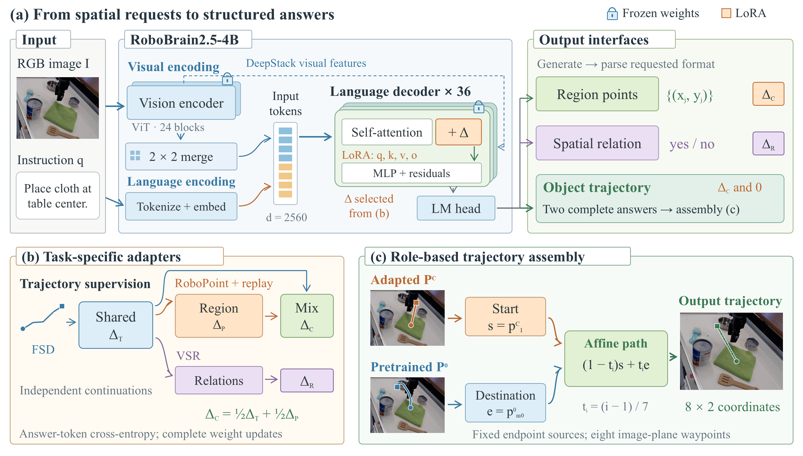

<h1 align="center">SpatialWeave</h1>

<p align="center"><strong>Selective Adaptation for Structured Spatial Understanding</strong></p>

> **Project status.** This repository currently hosts a brief project introduction and directory scaffold. Code and model weights are not part of this initial release.

<p align="center">
  <a href="#overview">Overview</a> ·
  <a href="#project-at-a-glance">Project at a glance</a> ·
  <a href="#release-contents">Release contents</a>
</p>

## Overview

SpatialWeave explores spatial understanding with vision-language models, covering region pointing, spatial relation judgments, and object-centric image-plane trajectories.

## Project at a glance

<p align="center">
  
</p>

*SpatialWeave framework. Original architecture figure from the manuscript.*

## Release contents

```text
SpatialWeave/
├── README.md
├── assets/
│   ├── README.md
│   └── overview.png
├── configs/
│   └── README.md
├── docs/
│   └── overview.md
├── scripts/
│   └── README.md
└── spatialweave/
    └── README.md
```

| Directory | Current contents |
| --- | --- |
| [assets](assets/) | Original manuscript architecture figure |
| [docs](docs/overview.md) | Brief task description |
| [spatialweave](spatialweave/) | Package directory placeholder |
| [configs](configs/) | Configuration directory placeholder |
| [scripts](scripts/) | Script directory placeholder |
